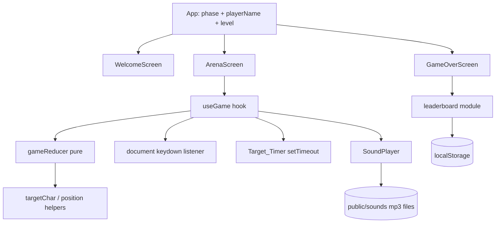

# Design Document

## Overview

Cyberpunk Key Smasher is a client-only single-page app built with Vite, React, TypeScript, and Tailwind CSS. The player registers, picks a level, and presses the key displayed in a neon Target_Box that jumps around the arena. Correct presses give 10 points. Wrong presses and timeouts cost a life. Three mistakes end the round and the score goes to a localStorage leaderboard. All sound effects are mp3 files served from `public/sounds/` and played with `HTMLAudioElement` through a `SoundPlayer`. There is no Web Audio API synthesis.

Key design decisions:

- Game rules live in a pure reducer (`gameReducer`) with no React, DOM, timer, or audio dependencies. This makes the rules easy to property test.
- Side effects (keydown listener, timer, audio, storage) live at the edges: a `useGame` hook, a `SoundPlayer` class, and a `leaderboard` module.
- Randomness is injected into pure helpers (`rng: () => number`) so tests can be deterministic.
- Screens are selected by a simple `phase` state. There is no router.

## Architecture



Suggested layout:

```
src/
  main.tsx, App.tsx, index.css
  game/
    types.ts          // Level, Phase, GameState, GameAction
    constants.ts      // LEVEL_SECONDS, CHARSET, SLOGANS, STORAGE_KEY
    reducer.ts        // gameReducer, createInitialState
    target.ts         // pickTargetChar, randomPosition
    keys.ts           // isModifierKey, matchesTarget
    name.ts           // sanitizeName, canStart
  audio/SoundPlayer.ts
  storage/leaderboard.ts
  hooks/useGame.ts
  components/ WelcomeScreen, ArenaScreen, TopBar, TargetBox, GameOverScreen, Leaderboard
public/
  sounds/
    correct.mp3       // correct key press (user-provided)
    wrong.mp3         // Mistake (user-provided)
    game-over.mp3     // Game_Over_Screen displayed (user-provided)
```

The mp3 files are static assets supplied by the user. Vite serves them at `/sounds/correct.mp3`, `/sounds/wrong.mp3`, and `/sounds/game-over.mp3`.

## Components and Interfaces

### Types and constants

```ts
export type Level = "easy" | "medium" | "hard";
export type Phase = "welcome" | "arena" | "gameover";

export const LEVEL_SECONDS: Record<Level, number> = {
  easy: 3,
  medium: 2,
  hard: 1,
};
export const MAX_NAME_LENGTH = 16;
export const MAX_LIVES = 3;
export const POINTS_PER_HIT = 10;
export const STORAGE_KEY = "cyberpunk-key-smasher:leaderboard";
export const CHARSET: readonly string[] = [
  ..."ABCDEFGHIJKLMNOPQRSTUVWXYZ0123456789",
  ..."!@#$%&*?+-=/<>()[]{};:,._~^|",
];
export const SLOGANS: readonly string[] = [
  /* at least 5 entries */
];
```

### Pure game logic

```ts
export interface Position {
  x: number;
  y: number;
}

export interface GameState {
  score: number;
  lives: number;
  level: Level;
  targetChar: string;
  position: Position; // top-left of Target_Box inside the arena
  timerSeconds: number; // full Target_Timer duration for the level
  timerEpoch: number; // incremented on every relocation; restarts the timer
  over: boolean;
}

export type GameAction =
  | {
      type: "KEY";
      key: string;
      repeat: boolean;
      rng: () => number;
      arena: Size;
      box: Size;
    }
  | { type: "TIMEOUT"; rng: () => number; arena: Size; box: Size };

export function createInitialState(
  level: Level,
  rng: () => number,
  arena: Size,
  box: Size,
): GameState;
export function gameReducer(state: GameState, action: GameAction): GameState;

// target.ts
export function pickTargetChar(
  previous: string | null,
  rng: () => number,
): string;
export function randomPosition(
  arena: Size,
  box: Size,
  rng: () => number,
): Position;

// keys.ts
export function isModifierKey(key: string): boolean; // Shift, Control, Alt, Meta
export function matchesTarget(key: string, target: string): boolean; // case-insensitive

// name.ts
export function sanitizeName(raw: string): string; // truncates to 16 chars
export function canStart(name: string, level: Level | null): boolean;
```

Reducer rules:

- `KEY` with `repeat === true`, a Modifier_Key, or `over === true` returns the same state.
- `KEY` matching the target: `score += 10`, relocate.
- `KEY` not matching: `lives -= 1`. If lives > 0, relocate. Otherwise `over = true`.
- `TIMEOUT`: same as a wrong key without the key check.
- Relocate: new `position`, new `targetChar` different from the previous one, and `timerEpoch += 1`.

### useGame hook

- On mount, creates the initial state and registers one `keydown` listener on `document`.
- Starts a `setTimeout` of `timerSeconds * 1000` keyed on `timerEpoch`. The effect cleanup clears the timeout, so each relocation restarts it from the full duration. The timeout dispatches `TIMEOUT`.
- Plays audio by comparing the previous and next state. A score increase plays `correct`. Any lives decrease (a Mistake, including the one that ends the round) plays `wrong`. The transition to `over` plays `gameOver`, so `wrong` plays first and `game-over` follows.
- When `over` becomes true, the hook clears the timer, removes the listener, and calls `onGameOver(score)`.
- Unmount cleanup clears the timer and removes the listener.

### SoundPlayer

```ts
export type SoundName = "correct" | "wrong" | "gameOver";

export const SOUND_URLS: Record<SoundName, string> = {
  correct: "/sounds/correct.mp3",
  wrong: "/sounds/wrong.mp3",
  gameOver: "/sounds/game-over.mp3",
};

export class SoundPlayer {
  constructor(createAudio?: (src: string) => HTMLAudioElement); // defaults to new Audio(src); injectable for tests
  preload(): void; // called on Game load; creates one element per file with preload = 'auto'
  prime(): void; // called from the START GAME click handler (inside the user gesture)
  play(name: SoundName): void; // rewinds to start, then plays
  playCorrect(): void; // play('correct')
  playWrong(): void; // play('wrong')
  playGameOver(): void; // play('gameOver')
}
```

Behavior:

- `preload` creates one `HTMLAudioElement` per file from `SOUND_URLS`, sets `preload = 'auto'`, and calls `load()`. Elements are cached and reused.
- `prime` runs inside the START GAME click. For each element it plays muted, then pauses and rewinds, so later programmatic playback is allowed by the browser's autoplay policy. The muted state is restored afterwards.
- `play` sets `currentTime = 0` and calls `play()`. Because the same element is reused, a sound that is still playing is rewound and restarted.
- `play()` returns a promise in modern browsers. The returned value is checked, and a rejection (autoplay blocked, missing file, decode error) is swallowed with `.catch(() => {})`. Browsers that return `undefined` are handled by the same check.
- Every public method is wrapped in try/catch, and each file is handled independently, so one failing element does not affect the others. If `Audio` is undefined, a constructor or `load()` throws, a file is missing, or any operation throws or rejects, the method is a silent no-op and gameplay continues.
- Only `HTMLAudioElement` is used. No `AudioContext`, `OscillatorNode`, or `GainNode`.

### Leaderboard module

```ts
export interface LeaderboardEntry {
  name: string;
  score: number;
  level: Level;
  savedAt: number;
  seq: number;
}

export function parseLeaderboard(raw: string | null): LeaderboardEntry[]; // never throws
export function serializeLeaderboard(entries: LeaderboardEntry[]): string;
export function loadLeaderboard(): LeaderboardEntry[]; // never throws
export function saveEntry(entry: Omit<LeaderboardEntry, "seq">): {
  entries: LeaderboardEntry[];
  saved: boolean;
};
export function topFive(entries: LeaderboardEntry[]): LeaderboardEntry[]; // score desc, ties by earlier seq
```

`seq` is a monotonically increasing insertion index that defines "earlier saved". `saveEntry` loads, appends, and tries to write. If the write throws, it returns the in-memory list with `saved: false`, so the Game_Over_Screen still shows the current round. The current entry is identified by `seq` for highlighting.

### Screens

- **WelcomeScreen**: name input (`maxLength=16`, value passed through `sanitizeName`), a level selector (radio group, no default selection on first load), and a START GAME button with `disabled={!canStart(name, level)}`. The click handler calls `sound.prime()` and then starts the game. The name stays in `App` state, so it is retained after PLAY AGAIN.
- **ArenaScreen**: renders `TopBar` (name, score, up to 3 life icons) and an arena container measured with a ref. The `TargetBox` is absolutely positioned at `state.position`.
- **GameOverScreen**: final score, a random slogan (chosen once per mount), the top-5 list with the current entry highlighted, and a PLAY AGAIN button.
- Styling: Tailwind with a dark background and neon palette (extended in `tailwind.config`), using glow `shadow` and `text-shadow` utilities. Interactive elements have visible focus styles and accessible labels.

## Data Models

```ts
// localStorage[STORAGE_KEY] = JSON array of LeaderboardEntry
[{ name: "NEO", score: 120, level: "hard", savedAt: 1700000000000, seq: 4 }];
```

`parseLeaderboard` validates each element's shape (string name, finite number score, valid level) and drops invalid items. Non-array JSON or a parse failure yields `[]`.

## Error Handling

- Missing, malformed, or unreadable storage (`getItem` throws, JSON invalid, wrong shape): treated as an empty leaderboard.
- `setItem` failure (quota, private mode): caught, `saved: false`. The current round is still shown.
- `Audio` unavailable, an mp3 file missing or undecodable, autoplay blocked, `play()` throwing synchronously, or the `play()` promise rejecting: `SoundPlayer` catches the error or rejection, the call is a no-op, and gameplay continues without sound. Rejections never surface as unhandled promise rejections.
- Arena smaller than the box: `randomPosition` clamps to `0`, so the box is never placed at a negative offset.
- Window resize during play: the next relocation uses the latest measured arena size.
- Rapid key presses after game over: the reducer ignores them because `over` is true, and the listener is removed.

## Correctness Properties

_A property is a characteristic or behavior that should hold true across all valid executions of a system-essentially, a formal statement about what the system should do. Properties serve as the bridge between human-readable specifications and machine-verifiable correctness guarantees._

### Property 1: Player name is limited to 16 characters

For any input string, `sanitizeName` returns a string of at most 16 characters that is a prefix of the input.

**Validates: Requirements 1.3**

### Property 2: Start is enabled only for a valid name and a selected level

For any name string and any level selection (including none), `canStart` is true if and only if the name contains at least one non-whitespace character and a level is selected.

**Validates: Requirements 1.4, 1.5**

### Property 3: Target position is fully inside the arena

For any arena size and box size where the box fits, `randomPosition` returns a position with `0 <= x <= arena.width - box.width` and `0 <= y <= arena.height - box.height`.

**Validates: Requirements 3.1**

### Property 4: Target character is from the set and differs from the previous one

For any previous character and any random source, `pickTargetChar` returns a character in `CHARSET` that is not equal to the previous character.

**Validates: Requirements 3.2, 3.6**

### Property 5: Relocation restarts the timer

For any state and any action that relocates the Target_Box (a correct key, or a mistake leaving lives above 0), the next state has `timerEpoch` increased by 1, a valid position, a new target character, and `timerSeconds` equal to the level's full duration.

**Validates: Requirements 3.4, 3.5, 4.3, 5.3**

### Property 6: Correct key scores

For any in-play state and any key that matches the target character ignoring letter case and is not a repeat, the reducer increases the score by exactly 10 and leaves lives unchanged.

**Validates: Requirements 4.2**

### Property 7: Mistakes cost one life

For any in-play state, any non-repeat key that is neither a Modifier_Key nor a case-insensitive match for the target, and any `TIMEOUT` action, the reducer decreases lives by exactly 1 and leaves the score unchanged.

**Validates: Requirements 5.1, 5.2**

### Property 8: Ignored inputs are no-ops

For any state, any Modifier_Key press, and any key event with `repeat` set, the reducer returns a state with the same score, lives, and timer epoch.

**Validates: Requirements 5.5, 5.6**

### Property 9: Game ends exactly when lives reach 0

For any sequence of reducer actions starting from a fresh state, `over` is true if and only if lives are 0, lives never go below 0, and no action changes the state after `over` is true.

**Validates: Requirements 6.1**

### Property 10: Leaderboard serialization round trip

For any list of valid leaderboard entries, `parseLeaderboard(serializeLeaderboard(entries))` equals the original list.

**Validates: Requirements 8.3**

### Property 11: Malformed storage yields an empty leaderboard without throwing

For any arbitrary string or null, `parseLeaderboard` does not throw and returns an array, and for any string that is not valid leaderboard JSON the array is empty.

**Validates: Requirements 8.4**

### Property 12: Top five ordering

For any list of entries, `topFive` returns at most 5 entries, ordered by score descending, with equal scores ordered by earlier `seq` first, and every returned entry has a score greater than or equal to that of every entry not returned.

**Validates: Requirements 7.3, 7.4**

### Property 13: Sound failures never break gameplay

For any failure mode of the audio layer (`Audio` missing or its constructor throwing, `load()` or `play()` throwing synchronously, or `play()` returning a rejected promise) and any sequence of `preload`, `prime`, and `play` calls for any sound name, `SoundPlayer` does not throw and produces no unhandled promise rejection.

**Validates: Requirements 9.5**

### Property 14: Playing a sound always restarts it

For any sound name and any current playback position of its element, calling `play` sets the element's `currentTime` to 0 before invoking `play()` on it.

**Validates: Requirements 9.4**

## Testing Strategy

Tooling: Vitest, React Testing Library, and fast-check for property tests. Each property test runs at least 100 iterations and is tagged in a comment with `Feature: cyberpunk-key-smasher, Property N: <title>`.

Property tests (fast-check) cover Properties 1 to 14. They target the pure modules (`name`, `target`, `reducer`, `leaderboard`) and `SoundPlayer` with a mocked `HTMLAudioElement` (a fake injected through the `createAudio` factory) whose `load`, `play`, `pause`, and `currentTime` can throw, return rejected promises, or return `undefined`.

Unit and example tests (React Testing Library, fake timers, mocked `SoundPlayer`, mocked `HTMLAudioElement`, and mocked `localStorage`):

- Welcome screen renders on load with input, level selector, and START GAME (1.1, 1.2, 1.6).
- Arena shows name, score, and 0 to 3 life indicators; a fresh round starts at score 0 and lives 3 (2.1 to 2.4).
- Target box shows a character and the timer starts at the level duration: 3, 2, and 1 seconds (3.2, 3.3).
- A keydown listener is attached in the arena and removed on game over and on unmount; no timers remain after unmount (4.1, 6.3, 10.4, 10.5).
- Correct key calls `playCorrect`; a mistake calls `playWrong`; game over calls `playGameOver` (4.4, 5.4, 6.2).
- `SoundPlayer.preload` creates elements for `/sounds/correct.mp3`, `/sounds/wrong.mp3`, and `/sounds/game-over.mp3` on load (9.2).
- Playing a sound that is already playing rewinds it to 0 and plays again (9.4).
- Game over saves an entry, shows the final score, a slogan from the list (list has at least 5 entries), the highlighted current entry, and PLAY AGAIN returning to a welcome screen with the name retained (6.4, 7.1, 7.2, 7.5 to 7.8).
- Storage: a fixed key is used, a throwing `setItem` still displays the current result, and a throwing `getItem` yields an empty list (8.1, 8.2, 8.5).
- START GAME click calls `SoundPlayer.prime`, which plays and pauses each element within the click handler (9.3).

Smoke checks: the build succeeds with `vite build`, Tailwind is configured, `public/sounds/` is referenced for exactly `correct.mp3`, `wrong.mp3`, and `game-over.mp3`, and a source scan finds no use of `AudioContext`, `webkitAudioContext`, `OscillatorNode`, or `GainNode` (9.1, 10.1 to 10.3). The visual style (1.7) requires manual review.
