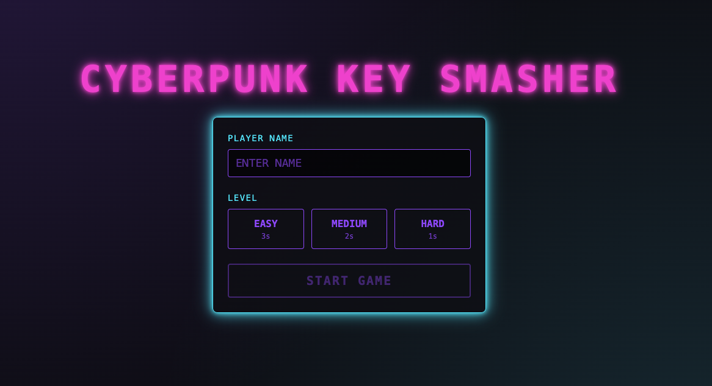
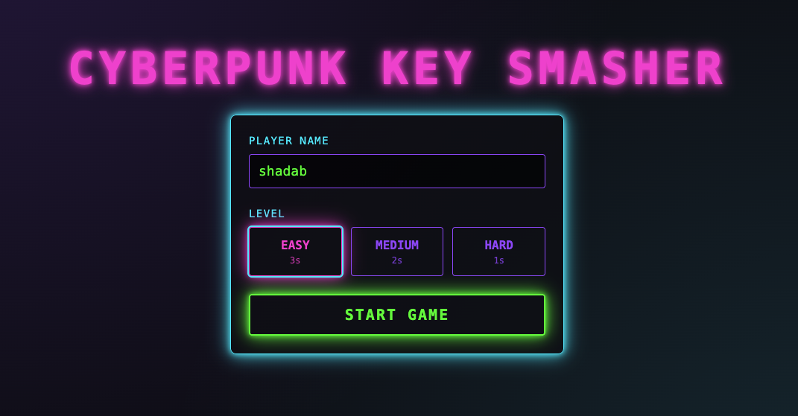
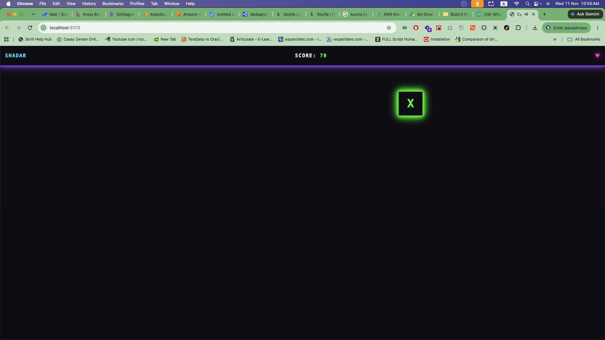
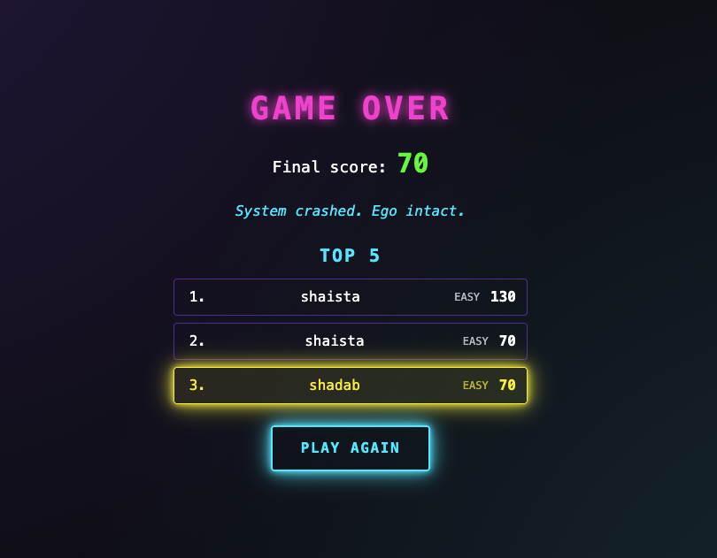

# Cyberpunk Key Smasher

A fast neon typing game for the browser. A glowing box shows a random character at a random spot on the screen. Press the matching key before the timer runs out. Miss three times and it is game over.

Built with React, TypeScript, Vite and Tailwind CSS.



## System requirements

| Tool | Version |
| --- | --- |
| Node.js | 22.22.2 or newer on the 22 line, 24.15.0 or newer on the 24 line, or 26+ |
| npm | 10.x or newer (ships with Node) |
| Browser | A current Chrome, Edge, Firefox or Safari |

The exact package versions below are pinned in `package.json`.

| Package | Version |
| --- | --- |
| React / React DOM | 19.3.1 |
| TypeScript | 5.9.3 |
| Vite | 8.3.8 |
| Tailwind CSS | 3.4.19 |
| Vitest | 5.1.0 |
| jsdom | 31.0.0 |
| fast-check | 4.10.2 |

Notes:
- Vite 8 needs Node 20.19+ or 22.12+. Vitest 5 and jsdom 31 are stricter, which is why the table above lists 22.22.2+ and 24.15+.
- The project was developed and tested on Node 23.11.0 and npm 10.9.2. That Node version is outside the supported range of Vitest and jsdom, so use an even-numbered release to be safe.

## Setup

```bash
# 1. Clone the repository
git clone https://github.com/Shaistaaman/Cyberpunk-Key-Smasher.git
cd Cyberpunk-Key-Smasher

# 2. Install dependencies
npm install
```

Then start the dev server with the `dev` script (see the commands table below) and open the URL Vite prints, usually http://localhost:5173.

### Sound files

The game plays three mp3 files from `public/sounds/`:

- `correct.mp3` plays on a correct key
- `wrong.mp3` plays on a mistake
- `game-over.mp3` plays when the game over screen appears

The game still works if a file is missing, it just stays silent for that event.

### Commands

| Command | What it does |
| --- | --- |
| `npm run dev` | Start the dev server |
| `npm test` | Run all tests once with Vitest |
| `npm run typecheck` | Type-check with `tsc --noEmit` |
| `npm run build` | Type-check, then build to `dist/` |
| `npm run preview` | Serve the production build locally |

## How to play

### 1. Enter your name and pick a level

Type your name (up to 16 characters) and choose a level. No level is selected at first. START GAME stays disabled until you have entered a name and picked a level.

| Level | Time per target |
| --- | --- |
| Easy | 3 seconds |
| Medium | 2 seconds |
| Hard | 1 second |



Click START GAME. This also unlocks audio in your browser.

### 2. Hit the keys

A neon box appears with one character in it. It can be a letter, a digit or a symbol. Press that key on your keyboard.

- **Correct key:** +10 points. The box jumps to a new spot with a new character.
- **Wrong key:** you lose a life.
- **Timer runs out:** you lose a life and the box moves.

You start with 3 lives. They show as hearts in the top bar, next to your name and score.



### 3. Game over

When your last life is gone you see your final score, a random slogan and the top 5 leaderboard. Your own entry is highlighted. Scores are saved in your browser's local storage, so they stay on your machine.



Click PLAY AGAIN to return to the welcome screen. Your name is kept, and you pick a level again.

## Project structure

```
src/
  audio/        SoundPlayer (preload, prime, play)
  components/   WelcomeScreen, ArenaScreen, TopBar, TargetBox, GameOverScreen, Leaderboard
  game/         Types, constants, reducer, key and target logic
  hooks/        useGame
  storage/      Leaderboard persistence (localStorage)
public/
  images/       Screenshots used in this README
  sounds/       correct.mp3, wrong.mp3, game-over.mp3
```

## Testing

Run `npm test`. The suite uses Vitest, React Testing Library and fast-check for property-based tests. It covers name handling, target placement, the game reducer, leaderboard storage, the sound player and the full UI flow.
